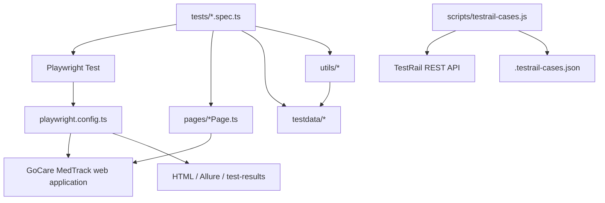

# Playwright JS Automation

Playwright Test automation for the GoCare MedTrack application. Tests are written
in TypeScript and cover login, employee search and creation, vaccination search,
and a basic application response check.

The application and TestRail are external systems. UI tests need a reachable
GoCare environment and a permitted test account.

## Architecture



### Main components

| Component | Responsibility |
| --- | --- |
| `tests/` | Playwright specs: arrange a scenario, call page objects, and assert outcomes. |
| `pages/` | Page Object Model classes with locators and user-level actions/assertions. |
| `testdata/` | JSON and CSV fixtures used by login and employee-related tests. |
| `utils/dataProvider.ts` | Synchronous JSON and CSV fixture readers. |
| `utils/randomDataGenerator.ts` | Faker-backed helpers for names, email, username, password, phone, and integers. |
| `scripts/testrail-cases.js` | Fetches TestRail cases through its API and writes a local case cache. |
| `playwright.config.ts` | Test discovery, app base URL, browser projects, authentication state, and reporters. |
| `.github/workflows/playwright.yml` | GitHub Actions workflow that installs dependencies/browsers and runs sanity tests. |

### Test flow

1. Playwright discovers TypeScript specs under `tests/`.
2. A spec creates or uses a page object, supplies fixture data, and performs a UI or API action.
3. Page objects interact with GoCare and expose assertions or state needed by the spec.
4. Playwright writes reports, traces, screenshots, and videos according to the config.

The app is an ASP.NET Web Forms application. Many controls use generated IDs such
as `ctl00_MedtrackContentPlaceHolder_*`; selectors in page objects reflect those
IDs. Prefer the existing page object when adding another test for the same page.

## Repository layout

```text
.
├── .github/workflows/playwright.yml
├── pages/
│   ├── CreateEmployeePage.ts
│   ├── HeaderNavigationPage.ts
│   ├── LoginPage.ts
│   ├── SearchEmployeePage.ts
│   └── SearchVaccinationPage.ts
├── scripts/
│   └── testrail-cases.js
├── testdata/
│   ├── create-emp-data.json
│   ├── employee-search.json
│   ├── logindata.csv
│   └── logindata.json
├── tests/
│   ├── api.spec.ts
│   ├── auth.setup.ts
│   ├── CreateEmployee.spec.ts
│   ├── LoginDataDriven.spec.ts
│   ├── login.spec.ts
│   ├── navigation.spec.ts
│   ├── searchEmployee.spec.ts
│   └── searchVaccination.spec.ts
├── utils/
│   ├── dataProvider.ts
│   └── randomDataGenerator.ts
├── package.json
├── playwright.config.ts
└── tsconfig.json
```

`test.config.ts` is a commented legacy example and is not the active
Playwright configuration. The active application `baseURL` is defined in
`playwright.config.ts`.

## Requirements and setup

- Node.js 20.6 or newer (the config uses `process.loadEnvFile`).
- npm.
- The GoCare environment must be reachable from the machine running the tests.
- A valid test account is required for authenticated UI tests.

Install dependencies and browser binaries:

```powershell
npm ci
npx playwright install chromium webkit
```

Create a local `.env` file in the repository root. Do not put real values in
source control:

```dotenv
MEDTRACK_USERNAME=your-test-username
MEDTRACK_PASSWORD=your-test-password

# Only needed when synchronizing cases from TestRail:
TESTRAIL_BASE_URL=https://your-company.testrail.net
TESTRAIL_USERNAME=your-testrail-username
TESTRAIL_API_KEY=your-testrail-api-key
TESTRAIL_PROJECT_ID=123
TESTRAIL_SUITE_ID=456
```

`MEDTRACK_USERNAME` and `MEDTRACK_PASSWORD` are used by `LoginPage` and
authenticated specs. TestRail variables are used only by the case-export
script; `TESTRAIL_SUITE_ID` is optional. The Playwright config loads `.env`
when the file exists.

## Running tests

```powershell
# List discovered tests without running them
npx playwright test --list

# Run the sanity-tagged tests
npm run test:sanity

# Run the Chromium suite, including its authentication setup dependency
npx playwright test --project=chromium --retries=0

# Run a single named test
npx playwright test tests/searchEmployee.spec.ts --grep "C8927857" --project=chromium

# Open the latest Playwright HTML report
npx playwright show-report
```

The `test:sanity`, `test:regression`, `test:master`, and
`test:datadriven` scripts select tests by matching tags in test titles.
Currently many functional specs use `@sanity`; add the corresponding tag to a
test before expecting the other grep-based scripts to select it.

### Browser and runner configuration

The config defines `setup`, `chromium`, and `webkit` projects. It uses a single
worker, retries once, a 20-second test timeout, a 1280x720 viewport, and
`headless: false`. Reports include HTML, Allure, dot, and list reporters.
Screenshots are saved on failure, videos are retained on failure, and traces
are recorded on first retry.

The `setup` project discovers `tests/auth.setup.ts`, logs in, and writes its
session to the ignored `playwright/.auth/user.json` file. Chromium and WebKit
depend on setup, so the state is created before browser tests start. Specs that
test login explicitly use an empty storage state. The legacy tracked `auth.json`
is no longer used by the active config, but remains sensitive and should not be
shared.

The GitHub Actions workflow runs `npm run test:sanity`. Its current YAML does
not map account credentials from repository secrets into the job environment;
configure that mapping before expecting authenticated CI tests to run.

## Tests and page objects

| Spec | Coverage |
| --- | --- |
| `tests/login.spec.ts` | C8928019 valid login with environment credentials. |
| `tests/auth.setup.ts` | Login and save browser state to the ignored `playwright/.auth` directory. |
| `tests/LoginDataDriven.spec.ts` | C8928020/C8928023 failure cases are opt-in; C8928021 blank fields and C8928022/C8928025 recovery-page navigation. |
| `tests/searchEmployee.spec.ts` | C8927857/C8927858, C9404218, C15239052, and C15239309. Search criteria are synthetic or reference a pre-seeded test record. |
| `tests/CreateEmployee.spec.ts` | C8927852 synthetic form preparation is non-submitting; persistent C8927852/C8927853 tests are skipped unless explicitly enabled. |
| `tests/searchVaccination.spec.ts` | C8935292/C8935293/C15237380 read-only search and validation cases. |
| `tests/navigation.spec.ts` | C15239053 My Details and C15239310 Change Password page navigation; no form submission. |
| `tests/api.spec.ts` | Read-only `GET /` login-page smoke check; no matching TestRail case ID. |
| `tests/test.spec.ts` | Empty placeholder. |

`tests/ViewEmp.spec.ts` is currently deleted in this worktree, so TestRail case
C8928070 (team-member search) is not part of the runnable suite.

Page objects keep selectors and repeated interactions out of test scenarios.
For example, `LoginPage` handles the login form and its arithmetic CAPTCHA, while
`SearchEmployeePage` and `SearchVaccinationPage` provide search-specific
operations and checks. Tests should keep expected behavior assertions visible
in the spec or in the relevant page object.

The TestRail export command is:

```powershell
npm run testrail:cases
```

It calls the TestRail `get_cases` API using read-only requests, follows page
offsets until the final page, and writes the cases to `.testrail-cases.json`.
The 294-case suite export was verified. The generated cache is ignored by Git
and is not required to run Playwright tests. No TestRail records are updated by
this project.

The current case-to-spec and execution map is in
[TESTRAIL_TRACEABILITY_MATRIX.md](./TESTRAIL_TRACEABILITY_MATRIX.md). The
[suite assessment](./TESTRAIL_SUITE_26097_ASSESSMENT.md) is the original
read-only baseline; the matrix reflects implementation work after that
assessment.

### Latest validation

On 2026-11-12, the full Chromium run discovered 21 tests: **17 passed and 4
were skipped**. The skips are the two authentication-failure cases and the two
persistent employee submissions, all gated for safety. The C8927852 synthetic
form-preparation check passed without submitting; no employee records were
created, modified, or deleted. WebKit was not run.

## Test data and external side effects

- `testdata/logindata.json` and `testdata/logindata.csv` contain scenario IDs
  and names only; they do not contain usernames or passwords.
- `testdata/create-emp-data.json` contains non-personal form defaults.
  `CreateEmployee.spec.ts` generates unique synthetic names, GIN values, and
  email addresses under the reserved `example.invalid` domain at runtime.
- `testdata/employee-search.json` points to the pre-seeded record used by
  positive employee and vaccination searches. Confirm it is dedicated
  non-production test data before running against another tenant.
- `DataProvider` reads JSON/CSV synchronously. `RandomDataUtil` exposes Faker
  helper methods; tests can use it when unique data is needed.
- Persistent employee submissions are guarded by
  `ENABLE_PERSISTENT_EMPLOYEE_TESTS=true`; do not set it without separate
  approval and a dedicated non-production tenant. The tests do not delete
  records. If a creation run is approved, cleanup must be done through the
  application by its authorized administrator or designated test-data owner.
- Authentication-failure tests are guarded by
  `ENABLE_AUTH_FAILURE_TESTS=true`. Invalid-password attempts can lock an
  account; C8928020 requires a dedicated test account.
- Do not use production accounts or personal data in new fixtures.

## Security and sharing this project with ChatGPT

Review and sanitize sensitive files before uploading this repository or its
contents to ChatGPT or any other external service:

- `.env` is ignored by Git, but contains local credentials when present.
- The legacy `auth.json` still contains browser session state and is tracked by
  Git in this checkout, although the active config now uses the ignored
  `playwright/.auth/user.json` path. Treat the legacy file as sensitive; expire
  its session and remove it from version control/history before sharing.
- Login fixtures no longer contain credentials, and employee-creation fixtures
  no longer contain personal email addresses. Continue to audit local `.env`,
  generated reports, and test artifacts before sharing.
- Never paste API keys, passwords, cookies, or session-state JSON into prompts,
  issues, or documentation.

## Guidance for ChatGPT-assisted changes

When asking ChatGPT to work on this repository, provide this README and the
specific spec/page object involved. Useful project-specific instructions:

1. Use Playwright Test and follow the existing page-object patterns.
2. Keep selectors consistent with the ASP.NET control IDs or accessible labels
   observed in the application.
3. Keep credentials in environment variables; never hardcode them in tests.
4. Use synthetic data and avoid persistent creates unless explicitly requested.
5. Add a focused assertion for the requested behavior and run the narrowest
   relevant test with `--project=chromium`.
6. Report external app outages, missing credentials, and data assumptions
   separately from code failures.
